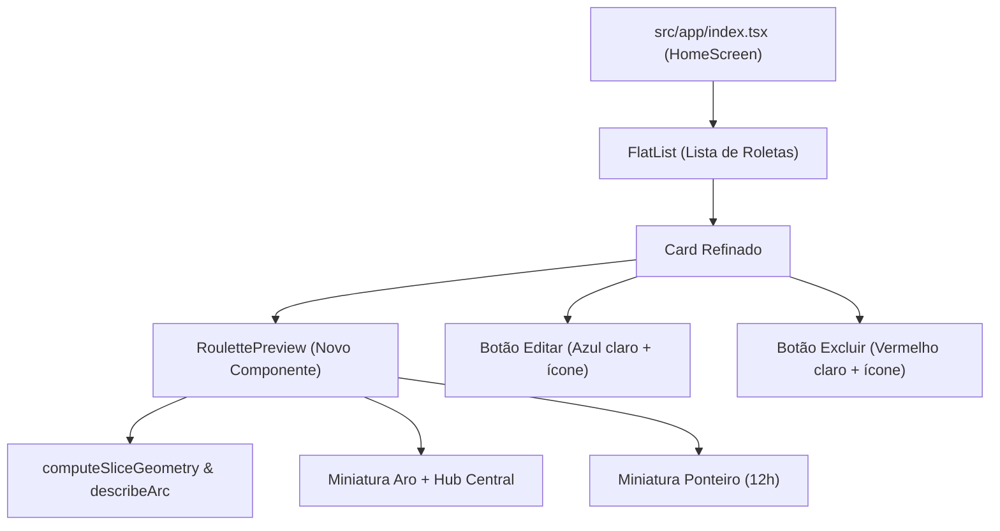

# Plano: Redesign do Card da Roleta e Novos Botões de Ação

## Objetivo e Visão Geral

Refinar a interface da tela inicial (`src/app/index.tsx`) para transformar os cards de roletas em representações fiéis e visuais de uma roleta real. A mudança contempla:

1. **Botões de Ação Intuitivos (Apenas Ícones)**:
   - Remoção dos rótulos de texto ("Editar" e "Excluir").
   - **Excluir**: Fundo vermelho suave (`#FEE2E2`), borda e ícone em vermelho mais intenso (`#FCA5A5` / `#DC2626`).
   - **Editar**: Fundo azul suave (`#E0F2FE`), borda e ícone em azul temático da aplicação (`#BAE6FD` / `#0284C7`).
   - Formato quadrado com cantos arredondados (34x34px), área de toque ergonômica (`hitSlop={8}`) e feedback visual de toque.
2. **Preview Visual da Roleta no Card (`RoulettePreview`)**:
   - Criação de um componente compacto e reutilizável (`src/components/roulette/RoulettePreview.tsx`).
   - Exibição de uma miniatura fiel da roleta configurada pelo usuário: fatias proporcionais com suas respectivas cores, aro externo (`#36415A`), hub central e o ponteiro no topo.
   - Tratamento para roletas vazias (exibição de placeholder de roleta estilizada).
3. **Refinamento do Layout do Card**:
   - Disposição harmoniosa em duas seções (Preview da Roleta à esquerda; Título, badges informativos e ações à direita).
   - Tipografia moderna, badge visual de itens e estados interativos aprimorados.

---

## User Review Required

> [!IMPORTANT]
> **Ação dos Botões no Card:**
>
> - O botão **Editar** no card atualmente abre o modal para **renomear o título da roleta** (comportamento existente de `handleEdit`). Ao tocar no corpo do card, o usuário navega para a roleta (`/roulette/[id]`), onde pode girar ou acessar a tela de itens. Esse fluxo será mantido, apenas com o novo visual.
> - Os botões de ação possuem isolamento no `Pressable` interno para garantir que tocar em Editar ou Excluir não acione o clique do card principal.

---

## Arquitetura e Diagrama de Componentes



---

## Proposed Changes

### Componente de Preview da Roleta

#### [NEW] `src/components/roulette/RoulettePreview.tsx`

Componente responsável por renderizar o mini preview SVG estático e otimizado da roleta.

- **Props**:
  - `items: RouletteItem[]`: lista de itens cadastrados na roleta.
  - `size?: number`: diâmetro total (padrão: `64`).
- **Renderização**:
  - Utiliza `react-native-svg` (`Svg`, `Path`, `Circle`, `Polygon`).
  - Quando houver itens: calcula a geometria com `computeSliceGeometry(items)` e desenha arcos com `describeArc`.
  - Fatias desabilitadas respeitam a opacidade e `DISABLED_COLOR`.
  - Quando a roleta estiver sem itens (`items.length === 0`): desenha uma grade padrão de 4 setores em tons pastéis suaves para indicar uma roleta vazia.
  - Aro e miolo central proporcional usando `FRAME_COLOR` (`#36415A`) e `#0D1C42`.
  - Ponteiro indicador miniatura no topo para dar o visual clássico da roleta.

```tsx
import Svg, { Circle, Path, Polygon } from "react-native-svg";
import { View } from "react-native";
import type { RouletteItem } from "@/types/roulette";
import { computeSliceGeometry, describeArc } from "@/utils/math";
import { FRAME_COLOR, POINTER_FILL, DISABLED_COLOR } from "@/utils/colors";

interface RoulettePreviewProps {
  items: RouletteItem[];
  size?: number;
}

export function RoulettePreview({ items, size = 64 }: RoulettePreviewProps) {
  const ringWidth = size * 0.06;
  const overhang = size * 0.05;
  const cx = size / 2;
  const cy = size / 2;
  const sliceRadius = size / 2 - ringWidth + 1;
  const hubRadius = size * 0.12;

  const geometries = computeSliceGeometry(items);

  return (
    <View
      style={{
        width: size,
        height: size + overhang,
        alignItems: "center",
        justifyContent: "center",
      }}
    >
      <Svg
        width={size}
        height={size + overhang}
        viewBox={`0 0 ${size} ${size + overhang}`}
      >
        {/* Camada das fatias */}
        {geometries.length > 0 ? (
          geometries.map((geo) => (
            <Path
              key={geo.item.id}
              d={describeArc(
                cx,
                cy + overhang,
                sliceRadius,
                geo.startAngle,
                geo.endAngle,
              )}
              fill={geo.item.isEnabled ? geo.item.color : DISABLED_COLOR}
              opacity={geo.item.isEnabled ? 1 : 0.45}
            />
          ))
        ) : (
          /* Placeholder para roleta sem itens */
          <>
            <Circle cx={cx} cy={cy + overhang} r={sliceRadius} fill="#F1F5F9" />
            <Path
              d={describeArc(cx, cy + overhang, sliceRadius, 0, 90)}
              fill="#E2E8F0"
            />
            <Path
              d={describeArc(cx, cy + overhang, sliceRadius, 180, 270)}
              fill="#E2E8F0"
            />
          </>
        )}

        {/* Aro externo */}
        <Circle
          cx={cx}
          cy={cy + overhang}
          r={size / 2 - ringWidth / 2}
          stroke={FRAME_COLOR}
          strokeWidth={ringWidth}
          fill="none"
        />

        {/* Hub Central */}
        <Circle cx={cx} cy={cy + overhang} r={hubRadius} fill="#0D1C42" />
        <Circle
          cx={cx}
          cy={cy + overhang}
          r={hubRadius * 0.65}
          fill={FRAME_COLOR}
        />

        {/* Mini Ponteiro */}
        <Polygon
          points={`${cx - size * 0.08},${overhang * 0.2} ${cx + size * 0.08},${overhang * 0.2} ${cx},${overhang + size * 0.12}`}
          fill={FRAME_COLOR}
        />
        <Polygon
          points={`${cx - size * 0.05},${overhang * 0.4} ${cx + size * 0.05},${overhang * 0.4} ${cx},${overhang + size * 0.09}`}
          fill={POINTER_FILL}
        />
      </Svg>
    </View>
  );
}
```

---

### Tela Principal (HomeScreen)

#### [MODIFY] `src/app/index.tsx`

- Importação do novo componente `RoulettePreview`.
- Atualização do `renderItem`:
  - Novo layout do card contendo o `RoulettePreview` na lateral esquerda.
  - Estruturação do bloco de informações (Título, badge de status de itens e dica "Toque para abrir").
  - Substituição dos botões de ação:
    - Botão de Editar: apenas `<Feather name="edit-3" size={15} color="#0284C7" />`, com estilo `styles.editButton`.
    - Botão de Excluir: apenas `<Feather name="trash-2" size={15} color="#DC2626" />`, com estilo `styles.deleteButton`.
    - Inclusão de `hitSlop={8}` para melhorar precisão do toque no mobile.
    - `accessibilityLabel` nos botões para acessibilidade.
- Atualização dos estilos (`StyleSheet`):
  - Layout horizontal `flexDirection: "row"` com espaçamento e padding equilibrados.
  - Adição de `editButton` e `deleteButton` com paleta temática e de exclusão.
  - Sombra sutil e borda fina `#F1F5F9` para acabamento refinado.

---

## Verification Plan

### Testes Automatizados e Verificação Estática

- Verificação de tipos TypeScript:
  ```bash
  npx tsc --noEmit
  ```

### Verificação Manual

1. **Visualização do Preview da Roleta**:
   - Abrir a aplicação e verificar os cards na tela inicial.
   - Observar se as cores e proporções das fatias no card correspondem fielmente aos itens cadastrados em cada roleta.
   - Testar o comportamento com uma roleta vazia (sem itens) para validar a renderização do placeholder limpo.
2. **Botões de Ação**:
   - Testar o botão **Editar**: verificar se tem ícone de edição em azul `#0284C7`, fundo azul claro `#E0F2FE`, borda azul suave `#BAE6FD` e se abre o modal de edição do título da roleta.
   - Testar o botão **Excluir**: verificar se tem ícone de lixeira em vermelho `#DC2626`, fundo vermelho claro `#FEE2E2`, borda vermelha suave `#FECACA` e se abre o modal de confirmação de exclusão.
   - Testar o toque nos botões para garantir que **não** naveguem para a tela da roleta ao serem clicados.
   - Testar o toque no card em si para confirmar que a navegação para `/roulette/[id]` continua funcionando perfeitamente.
