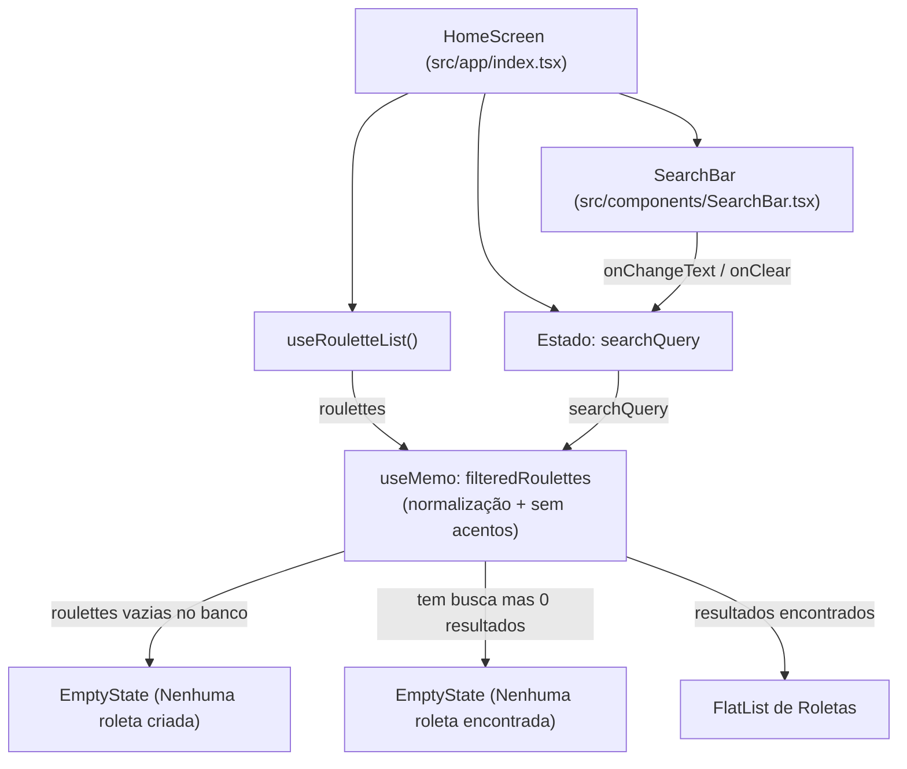

# Plano: Barra de Pesquisa Reutilizável (`SearchBar`) para Roletas

## Visão Geral e Objetivo

Implementar um componente reutilizável de busca (`SearchBar`) em `src/components/SearchBar.tsx` e integrá-lo à tela principal (`src/app/index.tsx`). A barra de pesquisa ficará posicionada no topo da listagem de roletas, imediatamente abaixo do header da aplicação (`Spinly`), permitindo aos usuários filtrar de forma rápida e dinâmica as roletas pelo título.

### Principais Benefícios:

1. **Componente Reutilizável e Acessível (`SearchBar`)**:
   - Ícone de lupa (`Feather/search`).
   - Botão para limpar a busca (`Feather/x` ou `x-circle`) que aparece dinamicamente quando há texto.
   - Suporte a propriedades customizáveis (`placeholder`, estilos de container e input, auto-capitalização, etc.).
2. **Busca Fluida e Insensível a Acentos**:
   - Filtragem dinâmica em tempo real (sem necessidade de pressionar "Enter").
   - Normalização de strings para busca insensível a maiúsculas/minúsculas e acentos (ex: pesquisar "musica" encontrará "Música").
3. **Tratamento de Estado Vazio Dedicado**:
   - Se o usuário não tiver nenhuma roleta cadastrada: mantém a mensagem original de boas-vindas ("Nenhuma roleta criada").
   - Se o usuário buscar por um termo que não retorne resultados: exibe um EmptyState contextual de busca ("Nenhuma roleta encontrada") com sugestão para limpar o termo.

---

## User Review Required

> [!IMPORTANT]
> **Posicionamento e Comportamento de Rolagem:**
>
> A `SearchBar` será posicionada de forma fixa logo abaixo do header e antes da `FlatList`.
>
> - **Vantagem**: Ao rolar uma lista longa de roletas, o campo de pesquisa continua sempre visível e acessível no topo, permitindo refinar ou limpar a busca a qualquer momento sem ter que rolar tudo de volta ao topo.
> - **Visibilidade quando vazio**: Se o usuário não tiver nenhuma roleta criada (`roulettes.length === 0`), a barra de pesquisa fica oculta para manter o visual limpo até a criação da primeira roleta.

> [!NOTE]
> **Compatibilidade de Importação:**
>
> O componente será criado diretamente em [src/components/SearchBar.tsx](file:///home/savior/coding/spinly/src/components/SearchBar.tsx), atendendo ao padrão do projeto (onde convivem componentes como `BaseModal.tsx` e `Spin.tsx`).

---

## Arquitetura e Fluxo de Dados



---

## Proposed Changes

### Componente Reutilizável: `SearchBar`

#### [NEW] [src/components/SearchBar.tsx](file:///home/savior/coding/spinly/src/components/SearchBar.tsx)

Criação do componente com suporte a:

- Ícone de pesquisa lateral esquerdo (`Feather` name="search")
- Campo `TextInput` estilizado e fluido
- Botão interativo para limpar campo (`Feather` name="x") exibido quando `value.length > 0`
- Propriedades tipadas (`SearchBarProps`) estendendo `TextInputProps` para flexibilidade total

```tsx
import React from "react";
import {
  View,
  TextInput,
  Pressable,
  StyleSheet,
  StyleProp,
  ViewStyle,
  TextStyle,
  TextInputProps,
} from "react-native";
import Feather from "@expo/vector-icons/Feather";

export interface SearchBarProps extends Omit<TextInputProps, "style"> {
  value: string;
  onChangeText: (text: string) => void;
  placeholder?: string;
  onClear?: () => void;
  containerStyle?: StyleProp<ViewStyle>;
  inputStyle?: StyleProp<TextStyle>;
}

export function SearchBar({
  value,
  onChangeText,
  placeholder = "Buscar roletas...",
  onClear,
  containerStyle,
  inputStyle,
  ...rest
}: SearchBarProps) {
  const handleClear = () => {
    onChangeText("");
    onClear?.();
  };

  return (
    <View style={[styles.container, containerStyle]}>
      <Feather
        name="search"
        size={18}
        color="#94A3B8"
        style={styles.searchIcon}
      />
      <TextInput
        style={[styles.input, inputStyle]}
        value={value}
        onChangeText={onChangeText}
        placeholder={placeholder}
        placeholderTextColor="#94A3B8"
        returnKeyType="search"
        autoCapitalize="none"
        autoCorrect={false}
        clearButtonMode="never"
        {...rest}
      />
      {value.length > 0 && (
        <Pressable
          onPress={handleClear}
          style={({ pressed }) => [
            styles.clearButton,
            pressed && styles.clearButtonPressed,
          ]}
          hitSlop={8}
          accessibilityLabel="Limpar busca"
          accessibilityRole="button"
        >
          <Feather name="x" size={16} color="#64748B" />
        </Pressable>
      )}
    </View>
  );
}

const styles = StyleSheet.create({
  container: {
    flexDirection: "row",
    alignItems: "center",
    backgroundColor: "#FFFFFF",
    borderRadius: 12,
    borderWidth: 1,
    borderColor: "#E2E8F0",
    paddingHorizontal: 12,
    height: 46,
    shadowColor: "#000",
    shadowOffset: { width: 0, height: 1 },
    shadowOpacity: 0.04,
    shadowRadius: 3,
    elevation: 1,
  },
  searchIcon: {
    marginRight: 8,
  },
  input: {
    flex: 1,
    fontSize: 15,
    color: "#1E293B",
    paddingVertical: 0,
  },
  clearButton: {
    padding: 4,
    borderRadius: 12,
    backgroundColor: "#F1F5F9",
    marginLeft: 6,
  },
  clearButtonPressed: {
    opacity: 0.7,
  },
});
```

---

### Tela Principal (`HomeScreen`)

#### [MODIFY] [src/app/index.tsx](file:///home/savior/coding/spinly/src/app/index.tsx)

- Importar o novo componente `SearchBar` de `../components/SearchBar` (ou `@/components/SearchBar`).
- Adicionar estado `const [searchQuery, setSearchQuery] = useState("");`.
- Adicionar computação de `filteredRoulettes` com memoização e normalização sem acentos:
  ```ts
  const normalize = (str: string) =>
    str
      .toLowerCase()
      .normalize("NFD")
      .replace(/[\u0300-\u036f]/g, "");

  const filteredRoulettes = useMemo(() => {
    const query = normalize(searchQuery.trim());
    if (!query) return roulettes;
    return roulettes.filter((roulette) =>
      normalize(roulette.title).includes(query),
    );
  }, [roulettes, searchQuery]);
  ```
- Renderizar a `SearchBar` no topo (abaixo do `Stack.Screen`), condicionada a `roulettes.length > 0`:
  ```tsx
  {
    roulettes.length > 0 && (
      <View style={styles.searchWrapper}>
        <SearchBar
          value={searchQuery}
          onChangeText={setSearchQuery}
          placeholder="Pesquisar roletas..."
        />
      </View>
    );
  }
  ```
- No corpo da tela:
  - Se `roulettes.length === 0`: renderiza `EmptyState` inicial ("Nenhuma roleta criada").
  - Se `roulettes.length > 0` e `filteredRoulettes.length === 0`: renderiza `EmptyState` com ícone 🔍 e mensagem "Nenhuma roleta encontrada".
  - Caso contrário: renderiza `FlatList` com `data={filteredRoulettes}`.

---

## Verification Plan

### Testes Automatizados

- Validação estática de tipos com o compilador do TypeScript:
  ```bash
  npx tsc --noEmit
  ```

### Verificação Manual

1. **Renderização Inicial**:
   - Abrir o app com roletas já existentes -> verificar se a barra de pesquisa aparece abaixo do header com o placeholder "Pesquisar roletas...".
2. **Filtragem por Texto e Acentos**:
   - Digitar parte do nome de uma roleta (ex: letras maiúsculas/minúsculas).
   - Digitar termos sem acento para títulos com acento (ex: "musica" para "Música") e validar que o filtro funciona corretamente.
3. **Botão de Limpar (X)**:
   - Digitar um texto -> verificar o aparecimento do ícone "x".
   - Tocar no "x" -> verificar se o texto é limpo instantaneamente e a lista volta a exibir todas as roletas.
4. **Estado Vazio de Busca**:
   - Digitar um termo inexistente (ex: "xyz123").
   - Verificar a exibição do `EmptyState` específico de busca mantendo a `SearchBar` visível para edição.
5. **Criação e Exclusão**:
   - Criar uma nova roleta enquanto a barra estiver vazia ou com termo que combine com o título criado.
   - Excluir uma roleta filtrada e verificar atualização reativa da lista.
